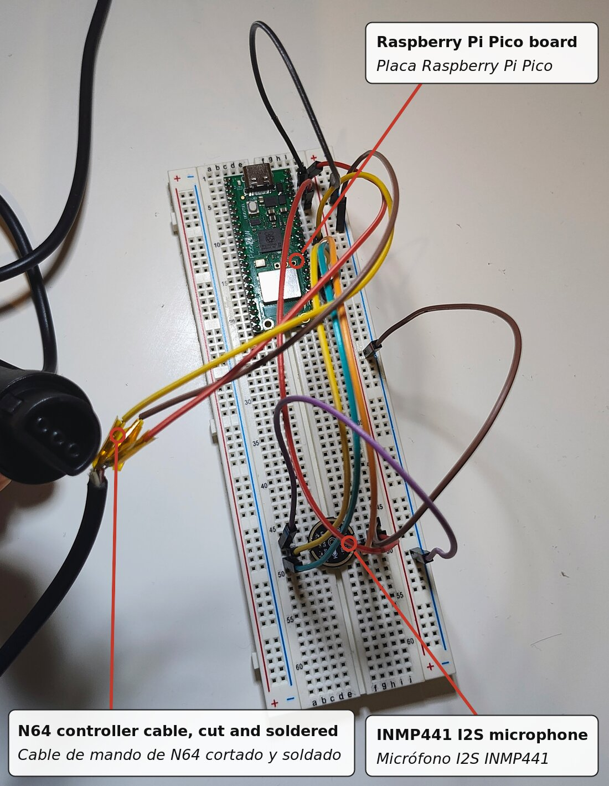

# ORU (Ocarina Recognition Unit): firmware de la Pico

[English](README.md) · **Español**

El **ORU** (Ocarina Recognition Unit) es el dispositivo físico del puerto 4. Funciona en una Raspberry Pi **Pico,
Pico W, Pico 2 o Pico 2 W**. Un micrófono I2S INMP441 escucha la ocarina. El ORU detecta cuál de las cinco notas de
Ocarina of Time suena y se la comunica a la N64 por el puerto de mando 4 con el protocolo `protocol/protocol.md`
v1.

> **Estado:** compila para las cuatro placas, y los tests en el PC cubren las partes compartidas. **Todavía no se
> ha ejecutado en hardware.** Consulta "Primera prueba" más abajo.

## Cableado



| Desde              | Hasta (Pico)                                                    | Pin de la Pico   |
| ------------------ | --------------------------------------------------------------- | ---------------- |
| INMP441 VDD        | 3V3(OUT)                                                        | 36               |
| INMP441 GND        | GND                                                             | 38 (o cualquier GND) |
| INMP441 L/R        | GND                                                             | 38 (o cualquier GND) |
| INMP441 SCK / BCLK | GP18                                                            | 24               |
| INMP441 WS / LRCLK | GP19                                                            | 25               |
| INMP441 SD         | GP20                                                            | 26               |
| DATA del puerto 4 de la N64 | GP22                                                   | 29               |
| 3,3 V del puerto 4 de la N64 | VSYS, a través de un diodo Schottky (ánodo en el lado de la N64). **El diodo es opcional**: ver las notas | 39 |
| GND del puerto 4 de la N64 | GND                                                     | 38               |

El conector de mando de la N64 tiene tres pines: GND, DATA (el del medio) y 3,3 V. Antes de conectar nada,
identifica GND y 3,3 V en tu propio cable o conector con un multímetro, con la consola encendida.

Notas:

- **DATA es de drenador abierto.** La consola tiene su propio pull-up a 3,3 V. El firmware solo pone la línea a
  nivel bajo o la suelta. Nunca conectes DATA a una fuente de 5 V.
- **El diodo en VSYS es opcional.** Permite conectar el USB, para la consola serie, mientras la Pico está en la
  consola. La Pico ya tiene un diodo de VBUS a VSYS, así que las dos alimentaciones no pueden pelearse. Sirve un
  BAT54 o un 1N5817. El regulador de la Pico funciona bien con los ~3,0 V que quedan tras el diodo.
- **Sin el diodo**, conecta los 3,3 V de la consola directamente a VSYS y **no conectes nunca el USB mientras el ORU
  está en la consola**. El USB pone ~4,7 V en VSYS y, sin el diodo, esa tensión vuelve a la línea de 3,3 V de la
  consola. Para usar la consola serie, desconecta antes el cable de 3,3 V (deja GND y DATA conectados).
- El consumo es de unos 25 mA para una Pico o Pico 2 con el micrófono. En las Pico W, el chip inalámbrico solo
  controla el LED, y se apaga junto con el LED unos segundos después de arrancar (ver "LED"). Es bastante menos
  de lo que el puerto le da a un Rumble Pak.
- Usa cables cortos para el micrófono: SCK va a 2 MHz.

## Flashear

1. Descarga `oru-firmware.zip` de la [última release](../../../../releases/latest) y descomprímelo. Usa el `.uf2`
   de tu placa: `oru-pico.uf2`, `oru-pico_w.uf2`, `oru-pico2.uf2` u `oru-pico2_w.uf2`. Una build para Pico W no
   funciona en una Pico normal, y una build para Pico 2 tampoco funciona en una Pico.
2. Mantén pulsado **BOOTSEL** y conecta la Pico por USB. Aparece una unidad llamada `RPI-RP2` o `RP2350`.
3. Copia en ella el `.uf2`. La Pico se reinicia con el firmware.

Cuando el firmware ya está en la placa, el comando `bootsel` de la consola serie hace el paso 2 por ti.

## LED

| LED                       | Significado                                                                                              |
| ------------------------- | -------------------------------------------------------------------------------------------------------- |
| Parpadeos cortos, 0,5 s   | Arrancando                                                                                               |
| **Encendido fijo**        | Funcionando, y el micrófono entrega audio                                                                |
| Parpadeo rápido (5 Hz)    | No llega audio del micrófono: no llega nada o la señal es constante (revisa SD, SCK, WS, L/R y VDD)     |

El LED solo muestra esto durante 5 segundos tras los parpadeos de arranque (`LED_SHOW_MS` en `src/config.h`);
después se queda apagado. En la Pico W / Pico 2 W el chip inalámbrico, que controla el LED, se apaga a la vez, así
que no consume nada de la consola. Para comprobar el micrófono más tarde, usa `status` en la consola serie.

El LED no dice nada sobre la consola. Para eso usa `status` en la consola serie; ver más abajo.

## Consola serie

USB CDC, a cualquier velocidad, por ejemplo `screen /dev/ttyACM0` o `picocom /dev/ttyACM0`. En Windows, usa PuTTY
en el puerto COM. Escribe `help`.

| Comando                   | Efecto |
| ------------------------- | ------ |
| `status`                  | Nota actual, frecuencia, cents, nivel y flags; transposición; ajustes; contadores del Joybus |
| `log on` / `log off`      | Muestra cada nota al terminar: el silencio previo (`gap`), su duración, `<- game` si dura lo bastante para que la ROM la acepte (`<- game?`: en el límite) y, cuando repite la nota anterior, si el juego ve una nota (`joined`, silencio de menos de ~33 ms) o dos (`repeat`, 50 ms o más). También los IDENTIFY y SET_TRANSPOSE de la consola |
| `set transpose <n>`       | Calibración en semitonos, que se suma a la octava de la consola. Usa `-12` para una ocarina una octava más grave |
| `set tolerance <cents>`   | Distancia máxima a una nota (por defecto 60) |
| `set minrms <x>`          | Umbral de entrada (por defecto 0.01) |
| `set yin <x>`             | Exigencia del detector (por defecto 0.20) |
| `set gain <0..8>`         | Ganancia del micrófono en potencias de dos (por defecto 2) |
| `save`                    | Guarda los ajustes en la flash. Pausa el Joybus unos ms, así que no lo hagas mientras el juego escucha |
| `defaults`                | Vuelve a los valores por defecto (`save` para conservarlos) |
| `bootsel`                 | Reinicia en el bootloader UF2 |

Los ajustes significan lo mismo que los de la sección `[Input-Ocarina]` del plugin, así que los valores que ajustes
con `aoc-mic-probe` en el PC sirven aquí. La excepción es la ganancia: `aoc-mic-probe` no tiene ese ajuste.

## Primera prueba (lista de comprobación)

1. **Solo el micrófono, alimentación por USB, sin N64.** El LED debe estar encendido fijo (los primeros 5 segundos).
   `status` debe mostrar `mic: ok`. Escribe `log on` y toca cada nota: A, C-Abajo, C-Derecha, C-Izquierda y
   C-Arriba deben dar D5, F5, A5, B5 y D6 (Re, Fa, La, Si, Re) a 0 cents, más o menos. Si el LED parpadea rápido,
   revisa el cableado del micrófono.
   - Si las notas salen siempre una octava desplazadas, usa `set transpose ±12`.
   - Si `rms` está por debajo de 0.01 mientras tocas, sube `set gain`.
   - Si `flags` muestra `clip`, bájala.
2. **En la N64, puerto 4, solo con la alimentación de la consola.** El LED debe estar encendido fijo 5 segundos y
   luego apagarse. Arranca la ROM con el hack, saca la ocarina y pulsa Cruceta Arriba.
   - El juego debe mostrar **"Listening..."**. Si además conectas el USB y activas `log on`, el log muestra
     `console: IDENTIFY` y `SET_TRANSPOSE +0`.
   - Toca la Nana de Zelda.
3. **Si el juego dice "Audio device not found."**, mira `status`:
   - `joybus: 0 replies`: no se recibe nada. Revisa DATA/GND y el pinout del conector.
   - Las respuestas aumentan, pero IDENTIFY nunca funciona: es un problema de tiempos. Las constantes están al
     principio de `src/joybus.pio`:

     - `SAMPLE_DELAY`: punto de muestreo, unos 2 µs después del flanco de bajada;
     - `FRAME_IDLE_LOOPS`: fin de trama;
     - `REPLY_IDLE_LOOPS`: cuánto tiempo debe estar libre la línea antes de empezar la respuesta, unos 3,5 µs.
       Los mandos reales responden 2–4 µs después del bit de stop.

     Un analizador lógico en DATA lo resuelve rápido.

## Desarrollo

Solo hace falta si quieres modificar el firmware: la release ya incluye los `.uf2`.

### Compilar

Necesitas el Pico SDK 2.x (`PICO_SDK_PATH`), `arm-none-eabi-gcc`, `cmake` y `ninja` o `make`.

```sh
cd firmware/pico
./build.sh                # todas las placas -> dist/oru-{pico,pico_w,pico2,pico2_w}.uf2
./build.sh pico2          # solo una
```

### Cómo funciona

Las respuestas Joybus salen del mismo modelo de dispositivo que usa el plugin del emulador
(`emulator/mupen64plus-input-ocarina/src/aoc_device.c`). El detector de altura también es compartido
(`aoc_pitch.c`, versión con enteros `aoc_pitch_track_s16`).

- **El núcleo 1** solo responde a la consola. Una máquina de estados PIO (`src/joybus.pio`) recibe los bytes del
  comando. El núcleo 1 llama a `aoc_device_process()` y pasa la respuesta a la misma máquina de estados, que espera
  a que termine el bit de stop de la consola y entonces envía la respuesta. Este código se ejecuta desde la RAM.
  Nunca espera al detector: lee la última nota publicada, una sola palabra de 32 bits.
- **El núcleo 0** lee el micrófono y ejecuta el detector:
  - Un segundo programa PIO (`src/i2s_mic.pio`) es el maestro I2S a 32 kHz. El DMA copia las muestras a un búfer
    circular.
  - Cada 4 ms, las últimas muestras pasan por un filtro de continua y la ganancia, y se convierten a 16 bits.
  - Cuando se baja la octava, las muestras además se diezman ×2/×4/×8, para que el detector cueste lo mismo en
    todas las octavas.
  - `aoc_pitch_track_s16()` procesa el resultado. Su bucle interno solo usa enteros, porque el RP2040 no tiene FPU.
  - El núcleo 0 también controla el LED y la consola USB.
- **SET_TRANSPOSE** de la consola (Cruceta Arriba/Abajo mientras escucha) se suma a la calibración `transpose`.
